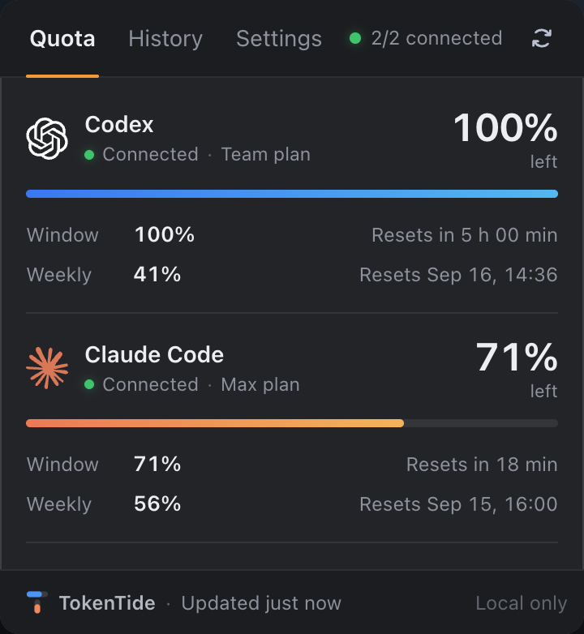
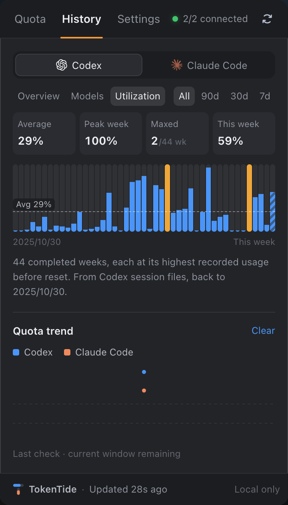

# TokenTide

English | [简体中文](README.zh-CN.md)

[](https://github.com/redbson/TokenTide/releases/latest) [](LICENSE)

TokenTide is a macOS menu-bar widget (with a [Windows tray version](#windows-preview)) that shows how much of your **Codex**, **Claude Code**, and **Qoder** quota is left, how many tokens **DeepSeek Harness** used, how much of each weekly quota you actually use, and your usage history. Everything is read locally from the command-line tools you are already signed in to: no account, no API key, and nothing leaves your Mac. (Two exceptions, both about DeepSeek: if you add a DeepSeek API key, TokenTide asks DeepSeek for your balance; and while DeepSeek is shown, it reads DeepSeek's public pricing page once a day to keep the cost estimate current. Nothing about you is sent with it.) The interface is in English and Chinese; it follows your Mac's language and can be switched in Settings.

**⬇ Download: [macOS](https://github.com/redbson/TokenTide/releases/latest/download/TokenTide.zip) · [Windows](https://github.com/redbson/TokenTide/releases/latest/download/TokenTide-Setup.exe)** · [All releases](https://github.com/redbson/TokenTide/releases)

<p>
  
  
</p>

## Features

- **Menu-bar readout**: two styles. **Detailed** shows small lines — `CX` / `CC` for the remaining current Codex and Claude Code window, and `QD` beside them for Qoder's credits. **Compact** is a small gauge — one vertical bar per tool, filled from the bottom to what's left — in about a fifth of the width. Hover either one for the exact numbers.
- **Quota tab**: current-window and weekly quota left for Codex and Claude Code, with reset countdowns; Qoder's own credits left (plan plus add-on; the team's org package has its own row and is not counted), with a row and credit count for each pool; a notice when a window drops below 20%; refreshes every minute while the panel is open (and on opening if older than 30 seconds), and every 1, 2, 5, or 10 minutes while only the menu bar shows it.
- **DeepSeek** (DeepSeek Harness is pay-as-you-go, so there is no quota): tokens, messages, and an estimated cost today and over the last 7 and 30 days, from Harness's session logs on this Mac. The cost prices each reply at DeepSeek's published rates for its hour (peak or off-peak, cache hits included), which TokenTide refreshes from DeepSeek's pricing page once a day; DeepSeek's bill is what counts. Add a DeepSeek API key in Settings to also see the API balance and what each period spent.
- **History · Overview / Models** (Codex, Claude Code, Qoder, and DeepSeek — Qoder is measured in credits, since it reports no tokens): sessions, messages, tokens, active days, streaks, peak hour, and top model, modeled on Claude Code's `/stats`, plus a 26-week heatmap.
- **History · Utilization**: how much of each weekly quota you actually used — average, peak week, weeks that maxed out, this week so far — with a bar per week, over the last 7, 30, or 90 days or all time. For Qoder, credits used per week.
- **Quota trend**: the current-window remaining quota across recent checks.
- **Settings tab**: language (English / Chinese / follow the system), launch at login, automatic updates, auto-refresh, and the low-quota notice.
- **Automatic updates**: when a new release is published, TokenTide downloads, verifies, and installs it by itself.

## Requirements

- macOS 13 or later (developed and tested on macOS 26), Apple silicon or Intel
- [Node.js](https://nodejs.org/) 20 or later (TokenTide's local service runs on Node)
- [Codex CLI](https://github.com/openai/codex) (`codex`) and/or [Claude Code](https://docs.anthropic.com/en/docs/claude-code) (`claude`), installed and signed in. Claude Code must be signed in with a claude.ai subscription (Pro / Max); API-key accounts have no plan quota to read. One of the two is enough; the other shows as Unavailable.
- Optional, for Qoder: the [Qoder CLI](https://docs.qoder.com/cli/installation) (`qodercli`), signed in. Qoder only appears when the Qoder app or CLI is installed; without the CLI it shows how to install it.
- Optional, for DeepSeek: the DeepSeek Harness app. DeepSeek only appears when it is installed.

## Installation

### Download (recommended)

1. Download [TokenTide.zip](https://github.com/redbson/TokenTide/releases/latest/download/TokenTide.zip) (or pick a version on [Releases](https://github.com/redbson/TokenTide/releases)), unzip it, and drag `TokenTide.app` into Applications.
2. First launch: TokenTide is not notarized by Apple, so macOS says it cannot verify the developer. Open System Settings → Privacy & Security and click **Open Anyway** near the bottom, or run:

   ```bash
   xattr -dr com.apple.quarantine /Applications/TokenTide.app
   ```

3. Later versions are downloaded and installed by TokenTide itself (see [Automatic updates](#automatic-updates)), so you won't see this prompt again.

To start TokenTide when you log in, turn on **Launch at login** in the panel's Settings tab. If macOS asks for approval, click **Open Login Items settings** and allow TokenTide in System Settings.

### Build from source

Requires the Xcode Command Line Tools (`xcode-select --install`).

```bash
git clone https://github.com/redbson/TokenTide.git
cd TokenTide
npm install
npm run build:mac
ditto release/TokenTide.app /Applications/TokenTide.app
open /Applications/TokenTide.app
```

The built app contains its own interface and local service, so you can move or delete the project folder afterwards.

## Windows (preview)

TokenTide also runs on Windows 10 and 11 (x64) as a tray app: the same panel, opened from an icon in the taskbar's notification area. It is new and has had less real-world use than the Mac app, so please [report problems](https://github.com/redbson/TokenTide/issues).

**[⬇ Download TokenTide-Setup.exe](https://github.com/redbson/TokenTide/releases/latest/download/TokenTide-Setup.exe)** (about 103 MB; it brings its own browser engine and Node.js, while the under-1 MB Mac app uses macOS's built-in engine and your installed Node.js)

- **Install**: run `TokenTide-Setup.exe`. It installs for your user only (no administrator rights) into `%LOCALAPPDATA%\Programs\TokenTide` and adds TokenTide to the Start menu. The installer is not code-signed, so Windows SmartScreen may say it protected your PC: click **More info → Run anyway**.
- **Requirements**: the same command-line tools as on the Mac, signed in: `codex` and/or `claude`, and optionally `qodercli` (`npm install -g @qoder-ai/qodercli`). npm installs and Claude Code's native installer (`%USERPROFILE%\.local\bin`) both work. Node.js is not required; TokenTide brings its own.
- **Tray icon**: one bar per shown tool, filled to its remaining quota (amber below 20%); hover for the exact numbers. If Windows hides it behind the **^** arrow, drag it onto the taskbar, or turn it on in Settings → Personalization → Taskbar → Other system tray icons.
- **Using it**: left-click the icon to open the panel, click elsewhere or press Esc to close it; right-click for Show Quota, Refresh Now, and Quit. **Launch at login** in Settings uses Windows' Startup apps.
- **Updates**: like the Mac app, TokenTide checks GitHub Releases every 6 hours, verifies the installer's SHA-256 checksum, and installs it silently when the panel is closed.
- **Files**: settings and quota records in `%APPDATA%\TokenTide` (`quota-weeks.json`, logs in `logs\service.log`), the history cache in `%LOCALAPPDATA%\TokenTide\Cache`. Claude Code's `/usage` screen fallback is not available on Windows.
- **Uninstall**: Settings → Apps → Installed apps → TokenTide.

## Automatic updates

- TokenTide checks the latest GitHub release shortly after it starts and every 6 hours after that.
- When there is a newer version, it downloads the zip and checks the SHA-256 checksum, bundle identifier, version, and code signature. Only if all of them match does it replace `TokenTide.app` and relaunch. It never installs while the panel is open; it waits until you close it.
- In Settings → Updates you can turn automatic updates off (you'll still be told about new versions), **Check for updates**, or install right away.
- If TokenTide sits somewhere you can't write to, it can't replace itself and asks you to download the update manually.

## Usage

- **Left-click** the menu-bar readout to open the panel; click anywhere else or press Esc to close it.
- **Right-click** for Show Quota, Refresh Now, and Quit. The panel footer also has Quit.
- **Quota**: quota left and reset times for each tool; the button at the top right refreshes immediately.
- **History**: switch between Codex, Claude Code, Qoder, and DeepSeek at the top (Qoder and DeepSeek appear once this Mac has their sessions; DeepSeek has a Balance view instead of Utilization: balance, spending per day, daily average, how long the balance lasts, and a spending record — each day's spending, top-ups, Harness tokens, and closing balance), then pick Overview / Models / Utilization and a range (All / 90d / 30d / 7d).
- **Settings**:
  - **Language**: English, Chinese (中文), or follow the system — Chinese when your Mac's primary language is Chinese, English otherwise. The menu-bar menu follows it too.
  - **Menu bar** (macOS): Detailed or Compact, see above.
  - **DeepSeek balance**: paste a DeepSeek API key. TokenTide checks it with DeepSeek before saving it in the macOS Keychain (on Windows, encrypted for your account), and only ever shows it masked. Remove it any time.
  - **Shown tools**: turn Codex, Claude Code, Qoder, or DeepSeek off to leave it out of the Quota tab, the menu bar, low-quota notices, and History. At least one tool stays on.
  - **Launch at login**: shows TokenTide in the menu bar after you log in. It uses macOS Login Items, so you can also turn it off in System Settings → General → Login Items.
  - **Automatic updates**: see [Automatic updates](#automatic-updates).
  - **Auto-refresh**: quota is read every minute while the panel is open; choose 1, 2, 5, or 10 minutes for while it is closed. Turn it off to read only when you open the panel or press refresh.
  - **History**: history and stats are counted again only when you open History and the last count is older than 15, 30, or 60 minutes; **Recount** under History, or the refresh button, counts now. The DeepSeek balance is asked for at most every 5 minutes, and DeepSeek's prices once a day.
  - **Low-quota notice**: shows a notice in the panel when the current window drops below 20%.

### How utilization is calculated

- Each **weekly quota window** counts once: the highest usage recorded before that window reset.
- The average, highest week, and weeks that hit the limit only include windows that have **ended**. The week in progress is shown separately as **This week** and drawn with stripes at the right end of the chart.
- **Codex** history comes from the quota snapshots in your local Codex session files, back to your earliest session.
- **Claude Code** keeps no quota history on your Mac, so TokenTide records it on every refresh. Weeks before that are **estimated** (hollow dashed bars, figures prefixed with "≈"):
  - Each reply's token usage in your local Claude Code transcripts is converted to its Anthropic API-price equivalent (pricier models and output weigh more; cache reads count at the much cheaper cache price).
  - The weeks TokenTide has recorded give a "percent of the weekly quota per dollar" factor, which is applied to earlier weeks, stepping back 7 days at a time from the recorded reset time.
  - The estimate only sees Claude Code usage on this Mac. Usage in claude.ai, the Claude app, or on other computers counts against the same weekly quota, so estimates **run low**; they get more accurate as more weeks are recorded. Claude Code keeps transcripts for about 30 days by default, so older weeks can't be estimated.
- If you switched accounts, each account's windows are counted separately.
- **Qoder**'s quota runs per plan period rather than weekly, so its Utilization view shows the credits your Qoder sessions on this Mac used each week, from `~/.qoder/projects`.

## Data sources and privacy

| Data | Source |
|---|---|
| Codex quota | `account/rateLimits/read` from `codex app-server` |
| Claude Code quota | A short-lived `claude -p` process sends the structured `get_usage` request (the same source as `/usage`). No prompt is sent, so it uses no quota. The request is marked experimental upstream; if it fails, TokenTide falls back to reading the `/usage` screen |
| Qoder credits | A short-lived `qodercli --print` process receives the structured `get_usage_info` request over stream-json (the data behind Qoder CLI's `/usage`). No prompt is sent, so it uses no credits; the account's user id is dropped |
| DeepSeek usage | DeepSeek Harness session logs, `~/.dsh/sessions` (Zstandard-compressed JSONL): the token counts each reply reports. Harness's credential store is never read |
| DeepSeek balance | Only with an API key you saved in Settings: `GET https://api.deepseek.com/user/balance`, every refresh. Balance readings are kept in `deepseek-balance.json` (TokenTide's data folder) to work out spending; drops count as spending, top-ups don't. They cover the whole account, not just Harness |
| DeepSeek prices | While DeepSeek is shown (Harness installed and not turned off in Settings), at most once a day: a plain `GET https://api-docs.deepseek.com/zh-cn/quick_start/pricing/` (DeepSeek's public pricing page; no key, cookie, or account data is sent). The price table is used only if every model has all its prices and off-peak is half of peak; it is kept in `deepseek-prices.json` (TokenTide's data folder). If the page can't be read or doesn't check out, the last good prices stay, and before the first good read TokenTide uses the prices it ships with. The cost tooltip says when prices were last checked |
| Usage history | Local transcripts: `~/.claude/projects/**/*.jsonl`, `~/.codex/sessions`, `~/.codex/archived_sessions`, `~/.qoder/projects/**/*.jsonl` (credits per reply for Qoder), and `~/.dsh/sessions` |
| Weekly utilization | Quota snapshots in Codex session files plus TokenTide's own records; earlier Claude Code weeks are estimated from local transcripts |

- From transcripts, TokenTide only counts messages, tokens, model names, and times. **It never reads or returns conversation content.**
- The local service listens on `127.0.0.1` only and rejects cross-origin requests. It never reads or records tokens, credentials, or account identifiers.
- When Claude Code fails to fetch fresh numbers from its server, it may report the last values it had.

Files TokenTide writes on your Mac:

| File | Purpose |
|---|---|
| `~/Library/Logs/TokenTide.log` | Local service log |
| `~/Library/Caches/TokenTide/usage-stats-v3.json` | Usage-history cache (only changed transcripts are re-read) |
| `~/Library/Application Support/TokenTide/quota-weeks.json` | Weekly quota records (the only source of Claude Code utilization history) |
| `~/Library/Application Support/TokenTide/deepseek-prices.json` | DeepSeek's prices from its pricing page, and when they were last checked |

## Troubleshooting

- **The panel says it couldn't start the local quota service**: make sure Node.js 20 or later is installed and `node` can be found in `~/.local/bin`, `/opt/homebrew/bin`, `/usr/local/bin`, or your login shell's PATH. Details are in `~/Library/Logs/TokenTide.log`.
- **Port 46173 is taken**: TokenTide uses port 46173 on `127.0.0.1`. If another program holds it, the panel says so instead of showing that program; quit it and TokenTide reconnects by itself within about 10 seconds. (Before 0.6.3 TokenTide used 4173, which is also `vite preview`'s default.)
- **An automatic update failed**: Settings → Updates shows the reason. You can always download the latest version from [Releases](https://github.com/redbson/TokenTide/releases/latest) and install it over the old one; your settings and records are kept.
- **A tool shows Unavailable**: run `codex`, `claude`, or `qodercli` once in Terminal and make sure you're signed in. If Claude Code is signed out, its block has a **Sign in to Claude Code** button that opens Terminal on `claude auth login`.
- **Claude Code says it couldn't fetch its quota just now**: Claude Code itself couldn't reach Anthropic's server (usually the network or a proxy). TokenTide retries once right away and again at the next refresh.
- **Qoder asks you to install the Qoder CLI**: run `curl -fsSL https://qoder.com/install | bash` (or `npm install -g @qoder-ai/qodercli`), then run `qodercli` once to sign in with the same account as the Qoder app.
- **Claude Code shows /usage fallback**: the `get_usage` request failed and TokenTide read the `/usage` screen instead. The numbers are still valid.

## Development

```bash
npm run dev                          # open http://127.0.0.1:5173/ (with live data)
npm test                             # unit tests
npm run build                        # build the panel into dist/client
npm run build:mac                    # build release/TokenTide.app for this Mac's architecture
npm run build:mac -- --universal     # build a universal (Apple silicon + Intel) app

npm --prefix windows ci              # Windows app: Electron and electron-builder
npm --prefix windows start           # run the Windows tray app from source (works on a Mac too)
node scripts/build-windows.mjs       # build release/windows/TokenTide-Setup-X.Y.Z.exe
```

The Vite dev server uses port 5173, so it doesn't collide with an installed TokenTide (port 46173). In a normal browser the panel is centered on a dark backdrop; in the app it fills the dropdown.

### Publishing a release

1. Set `version` in `package.json` to the new version, then commit and push (optional; the release tag wins).
2. Publish a GitHub release tagged `vX.Y.Z`, or run:

   ```bash
   gh release create v0.6.8 --generate-notes
   ```

3. The [release workflow](.github/workflows/release.yml) runs the tests, builds the universal Mac app and the Windows installer, and attaches `TokenTide-X.Y.Z.zip` and `TokenTide-Setup-X.Y.Z.exe`, their `.sha256` checksums, and unversioned `TokenTide.zip` / `TokenTide-Setup.exe` copies (used by the download links). Installed copies update themselves at their next check.
4. To rebuild an existing release, run the Release workflow manually from the Actions tab and enter its tag.

| Directory | Contents |
|---|---|
| `src/` | Panel UI (React) |
| `server/` | Local service: quota readers, transcript statistics, weekly quota records; `main.mjs` is the entry point bundled into the app |
| `macos/` | Menu-bar shell (Swift / AppKit + WKWebView) and automatic updates (`Updater.swift`) |
| `windows/` | Windows tray shell (Electron): tray icon, panel, updates (`updater.mjs`) |
| `.github/workflows/` | Release packaging; a Windows check (tests, installer, smoke run) |
| `branding/`, `public/assets/` | Icons |
| `scripts/` | App packaging (`build-macos.mjs`, `build-windows.mjs`) and icon generation |
| `tests/` | `node --test` tests |

## Changelog

### Unreleased
- Quota refreshes every minute while the panel is open; History updates less often.

### 0.6.7
- DeepSeek cost estimates follow DeepSeek's price changes on their own.

### 0.6.6
- See DeepSeek Harness usage and its estimated cost, in Quota and History.
- Add a DeepSeek API key to see your balance and a daily spending record.
- Codex and Qoder load more reliably, and failed refreshes keep the last reading.
- A new About section at the bottom of Settings.

### 0.6.5
- Clearer 30-day and 7-day views in History, with a date under each bar.
- The 7-day view shows this week's pace; Qoder shows credits per day.
- Codex weeks no longer include empty cycles, so averages are accurate.
- Weeks that were reset early are marked in the chart.

### 0.6.4
- A compact menu bar style that takes up less space.
- Release notes in the app, shown once after each update.

### 0.6.3
- No more port clashes with other developer tools, so the app stays connected.
- The background service restarts by itself if it stops.
- Your settings and quota trend carry over when you update.

### 0.6.2
- Sign back in to Claude Code with one click.
- Clearer message when Claude Code can't fetch its quota.

### 0.6.1
- Tidier wording in the Shown tools setting.

### 0.6.0
- Windows version (preview).
- Choose which tools to show.
- Qoder's percentage counts only your own credits.

### 0.5.0
- See your Qoder credits.
- Qoder in History.

### 0.4.0
- English and Chinese interface.
- English text fits the panel better.

### 0.3.0
- First downloadable release, for Apple silicon and Intel.
- Automatic updates.
- New Settings tab: launch at login, auto-refresh, low-quota notice.
- Weekly quota utilization in History.

See [Releases](https://github.com/redbson/TokenTide/releases) for every version.

## Disclaimer

TokenTide is an independent project and is not affiliated with OpenAI or Anthropic. Codex, OpenAI, Claude, Claude Code, and related marks are trademarks of their respective owners and are used only to identify the services being monitored.

## License

[Apache License 2.0](LICENSE)
